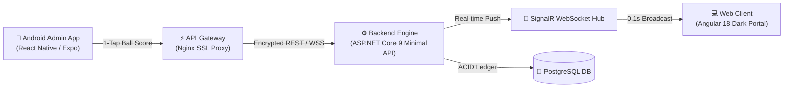

# 🏏 Ultra-Fast Cricket Live Line & Virtual Betting Platform
### Enterprise .NET 9 + Angular 18 + React Native Android Admin APK + PostgreSQL

[-38BDF8?style=for-the-badge&logo=android&logoColor=white)](https://demo.liveline.in/downloads/LiveLine-Admin.apk)

  <b>Sub-Second Real-Time Ball-by-Ball Live Scoring, Micro-Market Wagering, and Risk-Controlled Settlement Engine</b> 
  <i>Faster than mainstream TV and OTT streams by 1 to 2 deliveries. Zero monthly third-party API rentals required.</i>

[Explore Features](#-key-features) • [Try Live Demo](#-live-proof-of-work) • [Architecture](#-technology-stack) • [Commercial Licensing](#-commercial-licensing--pricing) • [Contact](#-get-in-touch)

---

## ⚡ The Latency Advantage

Traditional cricket websites rely on HTTP polling or 3rd-party iframe embeds that suffer from **3 to 8 seconds of latency**, exposing bookmakers and operators to latency arbitrage (courtsiding).

**LiveLine solves this with persistent SignalR WebSockets:**
* ⏱️ **< 100ms push latency** directly from the scorer's phone to thousands of concurrent web clients.
* 📱 **Dedicated Android Mobile Admin APK** featuring 1-tap scoring pads for boundaries (4, 6), dismissals, and extras.
* 🔐 **Biometric Thumb/FaceID Login** for operator authentication.
* 🛡️ **Instant Market Suspension** to freeze odds during DRS reviews or critical overs with 0 slippage.

---

## 🌐 Live Proof-of-Work (Test Now)

You don't need to take our word for it. Test the production system live right now:

| Target Component | URL / Access Link | Test Credentials |
| :--- | :--- | :--- |
| **Live Web Portal (SSL)** | [https://demo.liveline.in](https://demo.liveline.in) | Open in browser |
| **Android Admin APK (v1.0.11)** | [Download LiveLine-Admin.apk](https://demo.liveline.in/downloads/LiveLine-Admin.apk) | Direct APK download (47 MB) |
| **Interactive Video Simulator** | [30s Side-by-Side Demo](https://demo.liveline.in/demo-video.html) | Automated visual test |
| **YouTube Full Walkthrough** | [Watch on YouTube](https://youtu.be/DhjdDzdAiCg) | 1080p Video demo |
| **Instant Source Code ($99)** | [Buy on Gumroad](https://rausticwayc.gumroad.com/l/ylwhbf) | Instant .ZIP Download |
| **Admin Console Access** | In Admin App or Web Admin | `demo_admin` / `DemoPass#2026` |
| **Player Account (With 10k Credits)** | In Web Client | `demo_user` / `DemoPass#2026` |

---

## 🌟 Key Features

### 1. High-Performance Scoring Engine
- **1-Tap Ball Scoring Pad:** Score runs (0, 1, 2, 3, 4, 6), extras (Wides, No-balls, Byes, Leg-byes), and wickets in a single tap.
- **Autonomous Manual Scoring Mode:** Run your own matches without paying expensive third-party sports radar feeds.
- **Cricbuzz RapidAPI Integration:** Dual-mode capability to ingest external feeds or score fully autonomously.
- **Official Squads & Playing XI:** Manage player rosters, striker/non-striker strike rotation, and bowling spell overs.

### 2. Risk Management & Micro-Wagering
- **Ball-by-Ball Run Markets:** Live prediction on upcoming ball outcomes.
- **Instant Odds Lock:** 1-click market suspension freezes player wagers immediately.
- **Automated Ledger Settlement:** Winning bets settled automatically upon ball confirmation with double-entry ledger bookkeeping.

### 3. Ultra Low-Cost Cloud Deployment
- **Dockerized Architecture:** Runs seamlessly on a single **€5 to €10/month VPS** (UpCloud, Hetzner, DigitalOcean).
- Capable of sustaining **5,000+ concurrent WebSocket connections** on 2 vCPUs and 4GB RAM.

---

## 🏗️ Technology Stack

* **Backend:** ASP.NET Core 9 C# (Minimal APIs, SignalR WebSockets, Entity Framework Core).
* **Frontend:** Angular 18 (Responsive dark theme, RxJS, real-time score widgets, player wallet).
* **Mobile Admin:** React Native / Expo (Biometrics, offline recovery, 1-tap fast scoring pad).
* **Database:** PostgreSQL 16 (Audited double-entry credit ledger, state revisions).
* **DevOps:** Docker, Docker Compose, Nginx reverse proxy with automated SSL certificate provisioning.

---

## 🛒 Instant Purchase & Commercial Licensing

### ⚡ Option 1: Instant Source Code Download — `$99 Limited Launch Price`
[-FF90E8?style=for-the-badge&logo=gumroad&logoColor=black)](https://rausticwayc.gumroad.com/l/ylwhbf)

* **Instant Digital Delivery:** Instant automatic download of `LiveLine-Complete-Package.zip` (71.4 MB).
* **Complete Unlocked Codebase:** 100% full source code for ASP.NET Core 9 backend, Angular 18 web client, React Native mobile admin, and PostgreSQL schemas.
* **Pre-compiled Android APK:** Signed v1.0.11 APK included.
* **Turnkey Docker Setup:** 1-click `docker compose up -d` production deployment files.
* **Full Documentation:** Offline HTML guide and step-by-step installation instructions.
* **Commercial License:** Use on unlimited domains or resell to your own clients with zero recurring fees.
* 👉 **[Click Here to Buy Now on Gumroad ($99)](https://rausticwayc.gumroad.com/l/ylwhbf)**

---

### 🔹 Option 2: Turnkey White-Label Setup Service — `$499 USDT` (or ₹40,000)
* We deploy the complete solution on your own VPS within **24 hours**.
* Custom domain configuration (e.g., `yourbrand.com`) with automated lifetime SSL.
* Customized brand logo, platform name, and UI color theme.
* Compiled, custom-branded Android Admin APK ready for release.
* 30 Days of dedicated technical handover and onboarding support.

---

### 🔹 Option 3: Full Custom Enterprise Development — Custom Quote
* Dedicated custom sports feeds, proprietary odds algorithms, or white-label mobile app store publication assistance.

---

## 💳 Payment & Escrow

* **Cryptocurrency:** USDT (TRC-20 / BEP-20), Bitcoin, Ethereum.
* **Domestic Wire:** UPI / IMPS Bank Transfer.
* **Escrow Accepted:** Reputable forum escrow or milestone payments (50% upfront, 50% upon live demonstration handoff).

---

## 📩 Get in Touch

For inquiries, white-label quotes, or custom deployment requests:

* 💬 **Telegram:** [@YourTelegramHandle](https://t.me/)
* 🌐 **Live Demo:** [https://demo.liveline.in](https://demo.liveline.in)
* 📥 **APK Download:** [https://demo.liveline.in/downloads/LiveLine-Admin.apk](https://demo.liveline.in/downloads/LiveLine-Admin.apk)

  © 2026 LiveLine Platform. Enterprise Live Sports Technology. All rights reserved.

